# Pràctica

## Objectiu

Preparar el servidor `SRV-AD-01` i promocionar-lo com a primer controlador de domini del domini `musiccloud.local`.
## Escenari

L’empresa **MusicCloud** vol iniciar la implantació d’Active Directory Domain Services.

El servidor Windows Server que s’utilitzarà com a controlador de domini serà:
```text
SRV-AD-01
```
El domini que es crearà serà:
```text
musiccloud.local
```
Aquest servidor també proporcionarà el servei DNS del domini.
## Tasques

### Part 1. Configuració inicial del servidor

Configureu el servidor perquè compleixi els requisits següents:

| Element           | Valor              |
| ----------------- | ------------------ |
| Nom del servidor  | `SRV-AD-01`        |
| Adreça IP         | fixa               |
| DNS preferit      | el mateix servidor |
| Connexió de xarxa | operativa          |
| Zona horària      | correcta           |
| Hora del sistema  | correcta           |
La configuració IP concreta dependrà de la xarxa del laboratori. Anoteu els valors utilitzats.


Completeu la taula següent:

| Paràmetre        | Valor configurat                            |
| ---------------- | ------------------------------------------- |
| Adreça IP        | 192.168.1.10                                |
| Màscara          | 255.255.255.0 és ha dir /24                 |
| Porta d’enllaç   | 192.168.1.10                                |
| DNS preferit     | 192.168.1.10                                |
| Nom del servidor | `SRV-AD-01`                                 |

1. **Canviem el hostname del servidor:**
*Per canviar el hostname del servidor hem d'utilitzar la següent comanda:*
```powershell
Rename-Computer -NewName "NomDesitjat" -Restart
```

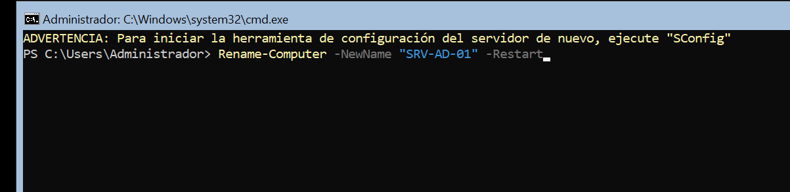

2. **Configurar la IP fixa de la xarxa del domini:**

*Per configurar una IP fixa a la xarxa del domini hem d'executar les següents comandes:*
```powershell
//Abans de configurar com en aquest cas tenim dues interficies de xarxa hemd e saber a quina hem de aplicar la configuració, i ho farem amb ipconfig /all i miran el nom de l'interficie que volem hem de configurar.' Després ja podem executar la comanda per configurar.
New-NetIPAddress `
-InterfaceAlias "Nom de l'interficie" `
-IPAddress "IP fixa desitjada" `
-PrefixLength 24
```

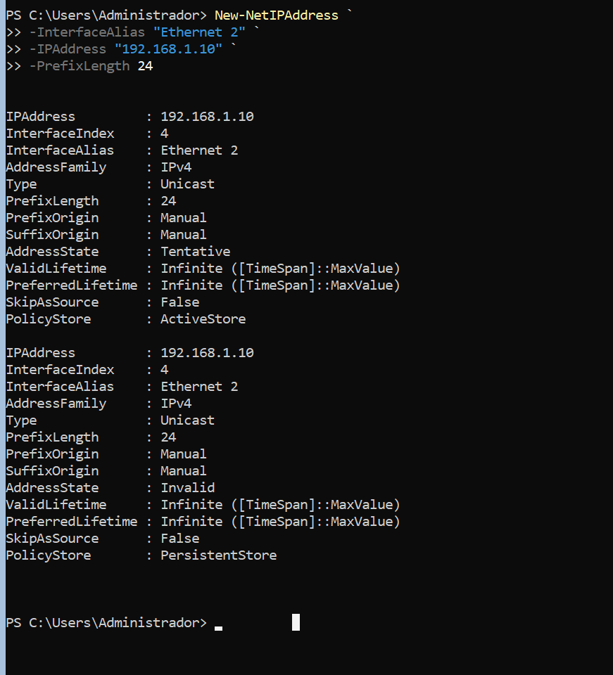

3. **Configurar DNS:**

*Per configurar el DNS a l'interfície del domini és fa amb la següent comanda:*

```powershell
Set-DnsClientServerAddress `
-InterfaceAlias "Nom de l'interfície del domini" `
-ServerAddresses "IP del servidor"
```

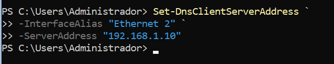

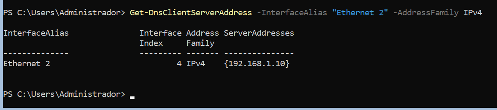

4. **Configurar la zona horària:**

*Per configurar la zona horària es fa amb la següent comanda:*

```powershell
Set-TimeZone -Id "Romance Standard Time"

//Per comprovar que la zona horària és correcta és fa amb la següent comanda.
Get-TimeZone
```

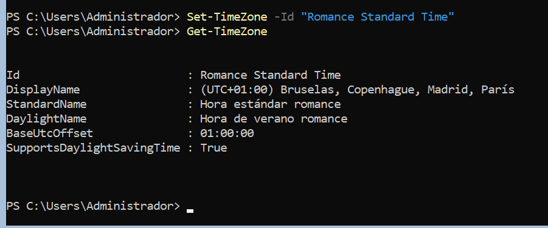

5. **Comprovar que l'hora es correcta:**

*Per comprovar que l'hora és la correcta és fa amb la següent comanda:*

```powershell
Get-Date
```

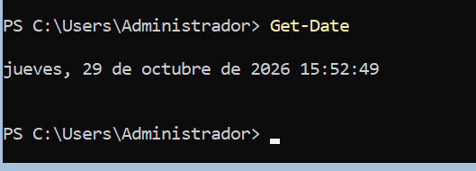

### Part 2. Instal·lació del rol AD DS

Localitzeu i utilitzeu el procediment adequat per instal·lar el rol AD DS i promocionar el servidor a controlador de domini. Documenteu breument les comandes o passos utilitzats.

1. *Per instalar el rol AD DS és fa amb la següent comanda:*

```powershell
Install-WindowsFeature AD-Domain-Services -IncludeManagementTools
```

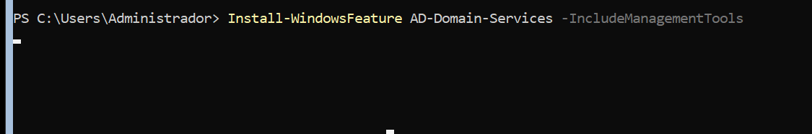

2. *Una vegada hem instal·lat el rol AD DS o hem de comprovar que s'ha instalat correctament amb la següent comanda:*

```powershell
Get-WindowsFeature AD-Domain-Services
```

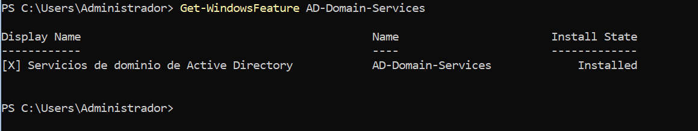


### Part 3. Promoció a controlador de domini
Promocioneu el servidor a controlador de domini amb les opcions següents:

| Opció                                  | Valor              |
| -------------------------------------- | ------------------ |
| Tipus d’implantació                    | Crear un nou bosc  |
| Nom del domini arrel                   | `musiccloud.local` |
| Servidor DNS                           | Sí                 |
| Catàleg global                         | Sí                 |
| Nom NetBIOS                            | `MUSICCLOUD`       |
| Controlador de domini de només lectura | No                 |
| Reinici final                          | Sí                 |
Definiu una contrasenya segura per al mode de restauració de serveis de directori.

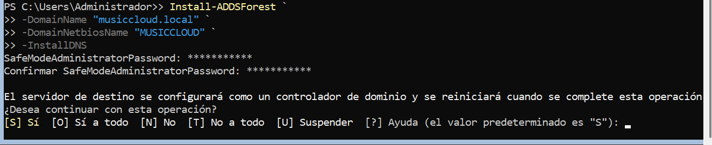


### Part 4. Verificació

Després del reinici, comproveu:

1. Que el servidor s’anomena `SRV-AD-01`.
    
    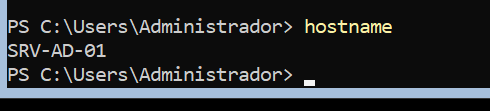

2. Que el domini `musiccloud.local` existeix.
    
    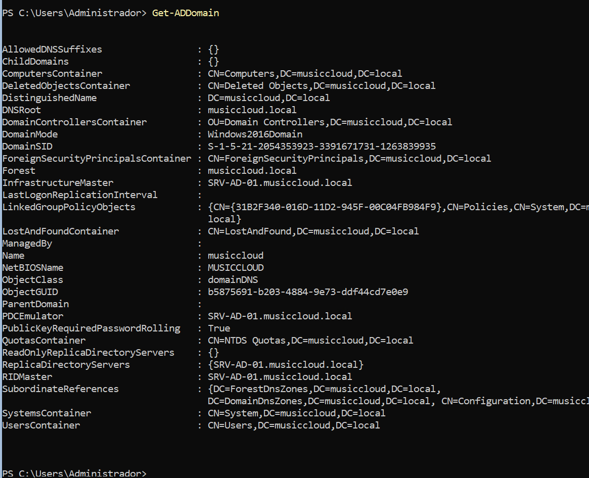

3. Que el servidor és controlador de domini.
    
    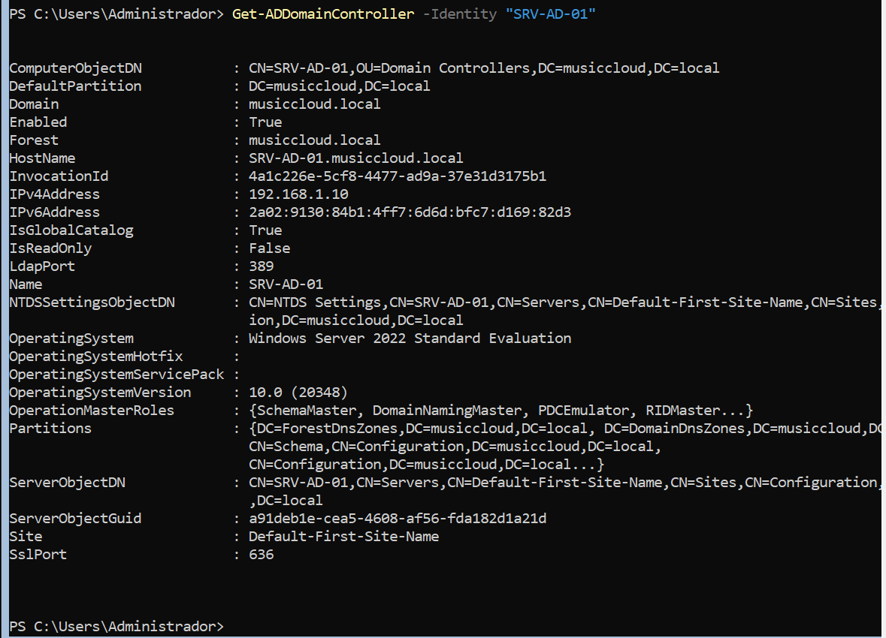

4. Que el servei DNS està instal·lat.
    
    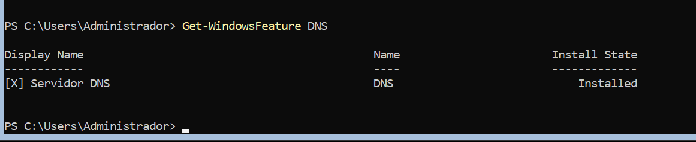

5. Que el DNS resol correctament el domini.
    
    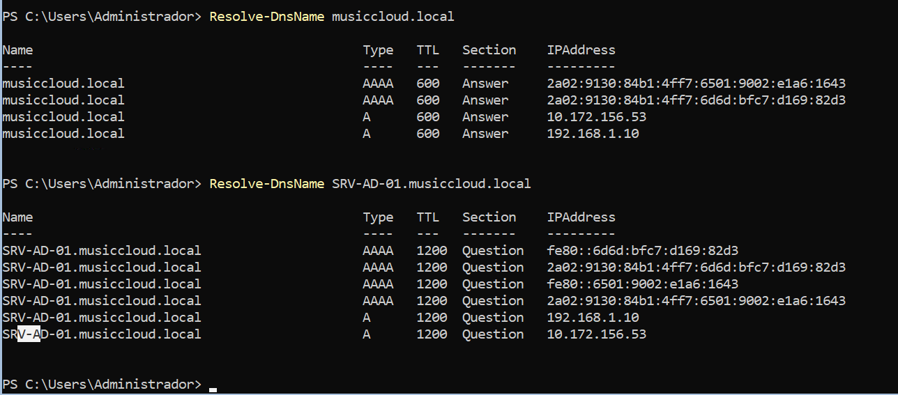

    
Completeu la taula següent. Adjunta la comanda que has utilitzat per a cada una de les comprovacions.

*Ja he adjuntat una captura de les comandes que he utilitzat per a cada una de les comprovacions en la part de verificació.* 

| Comprovació                                                                      | Resultat                     |
| ---------------------------------------------------------------------------------|------------------------------|
| Nom del servidor   `Hostname`                                                    | `SRV-AD-01`                  |
| IP fixa configurada    `Get-NetIPConfiguration`                                  | 192.168.1.10                 |
| AD DS instal·lat  `Get-WindowsFeature AD-Domain-Services`                        | `Installed`                  |
| Domini creat      `Get-ADDomain`                                                 | `musiccloud.local`           |
| DNS instal·lat   `Get-WindowsFeature DNS`                                        | `Installed`                  |
| Resolució de DNS `Resolve-DnsName musiccloud.local`                              | `Resolució correcta`         |
| Eines d’Active Directory disponibles `Get-Module -ListAvailable ActiveDirectory` | `Modul disponible`           |


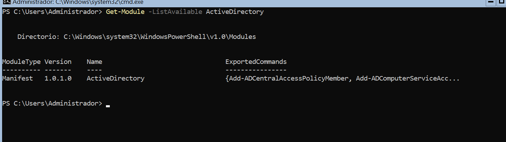


## Preguntes

Responeu breument:

1. Per què `SRV-AD-01` necessita una IP fixa?
    
    *Perquè els clients i els serveis del domini han de poder localitzar el controlador de domini i el servidor DNS mitjançant una adreça IP estable.*

2. Per què és necessari DNS en un domini Active Directory?
    
    *Perquè Active Directory utilitza DNS per localitzar contorladors de domini i serveis com LDAP i Kerberos, necessaris per a l'autenticació i l'adminsitració del domini.*
    
3. Quina diferència hi ha entre instal·lar AD DS i promocionar el servidor a controlador de domini?
    
4. Quin és el nom del domini creat?
    
5. Quin és el nom NetBIOS del domini?
    
6. Per què no és recomanable que els clients del domini utilitzin un DNS extern com a DNS principal?