# Enunciat

## Objectiu

Crear l’estructura inicial d’unitats organitzatives del domini `musiccloud.local`.
## Escenari

MusicCloud ja disposa del domini:
```text
musiccloud.local
```
El servidor `SRV-AD-01` ja és controlador de domini.

Ara cal crear una estructura d’unitats organitzatives que permeti organitzar els objectes de l’empresa.
## Estructura que cal crear

Creeu l’estructura següent:
```text
musiccloud.local
└── MusicCloud
    ├── Usuaris
    │   ├── Administracio
    │   ├── Comercial
    │   ├── Desenvolupament
    │   ├── Sistemes
    │   └── Direccio
    ├── Equips
    │   ├── Clients
    │   └── Servidors
    └── Grups
```
## Part 1. Creació de la UO principal

Creeu una unitat organitzativa principal anomenada:
```text
MusicCloud
```
Aquesta UO serà el contenidor principal de l’estructura de l’empresa.

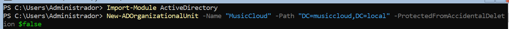


## Part 2. Creació de les UO de primer nivell

Dins de la UO `MusicCloud`, creeu les UO següents:
```text
Usuaris
Equips
Grups
```

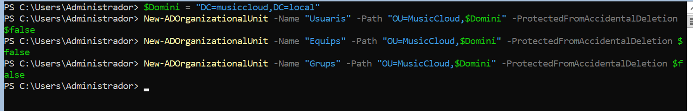


## Part 3. Creació de les UO de departaments

Dins de la UO `Usuaris`, creeu les UO següents:
```text
Administracio
Comercial
Desenvolupament
Sistemes
Direccio
```

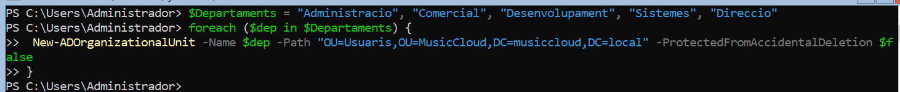


## Part 4. Creació de les UO d’equips

Dins de la UO `Equips`, creeu les UO següents:
```text
Clients
Servidors
```

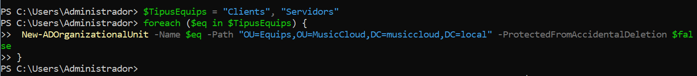


## Part 5. Verificació

Executeu una consulta que mostri totes les unitats organitzatives del domini.

La sortida ha de mostrar, com a mínim, les UO creades en aquesta pràctica.


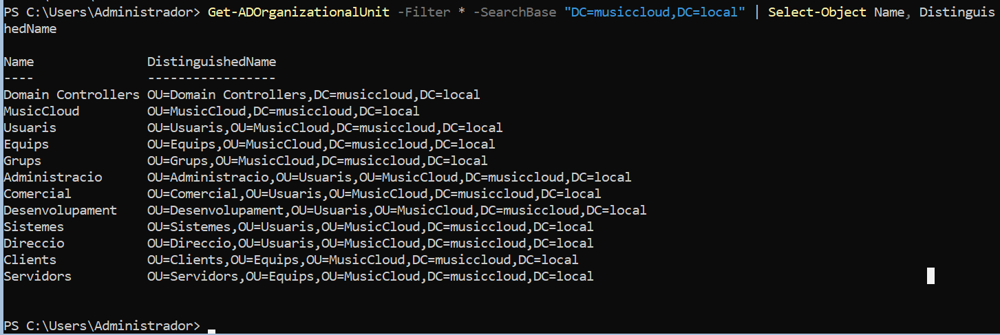


## Part 6. Preguntes

Responeu breument:

1. Per què és útil crear una UO principal anomenada `MusicCloud`?  
   
   *Permet agrupar i aïllar tots els objectes propis de l'organització respecte als usuaris o ordinadors predeterminats del sistema, facilitant l'aplicació de Polítiques de Grup (GPOs) globals i la delegació d'adminsitració.*

2. Per què se separen `Usuaris`, `Equips` i `Grups`?  
   
   *Per mantenir una jerarquia neta i organitzada, la qual cosa facilita la localització dels objectes i permet aplicar GPOs o permisos específics per tipus d'objecte sense afectar-ne d'altres.*

3. Per què els departaments s’han creat dins de `Usuaris`? 

   *Perquè organitzen lògicament a les persones segons el seu rol i departament dins de l'empresa, facilitant la gestió d'usuaris i l'assignació de recursos compartits.*

4. Per què no és recomanable deixar tots els usuaris dins del contenidor `Users`?  
   
   *El contenidor `Users` per defecte no és la UO, per la qual cosa no admet l'aplicació de GPOs. a més tots els comptes dificulta enormement la seguretat i l'administració de l'entorn.*


## Part 7. Creació scripts

- 7.1. Crea un script per eliminar totes les OUs creades en la pràctica
  
  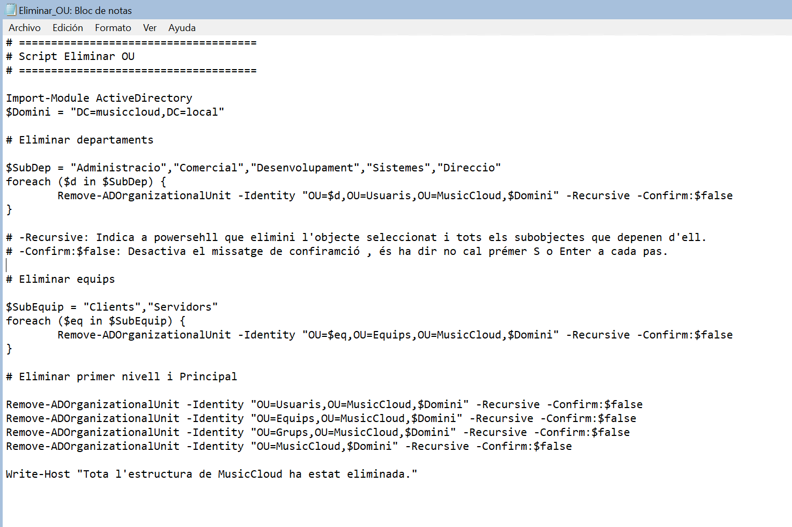

  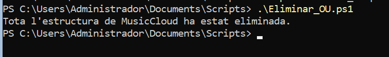

- 7.2. Crea un script que crei l'OU principal (musiccloud).
  
  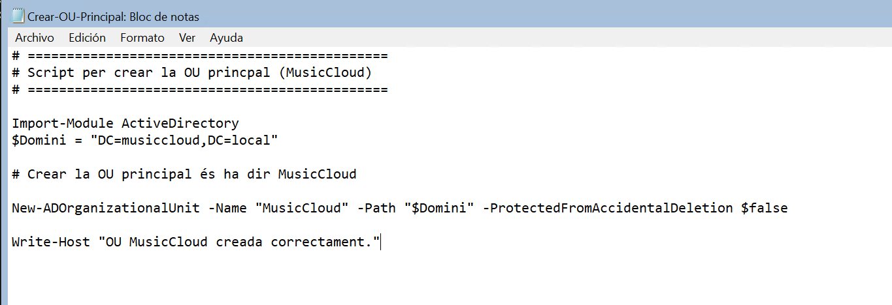

  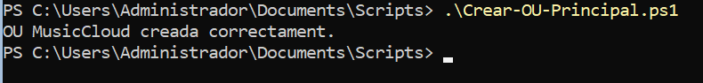

- 7.3. Crea un script que crei l'OU principal i les OUs descendents: Usuaris, Equips i Grups
  
  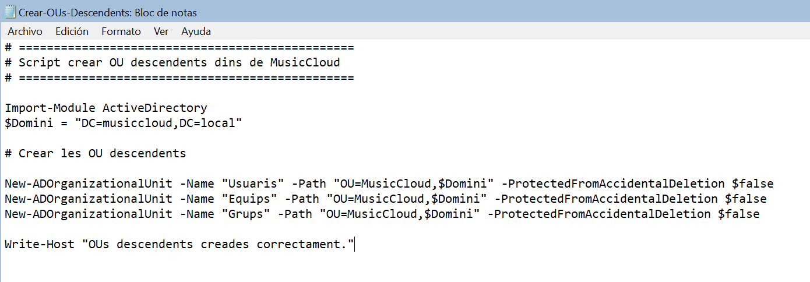

  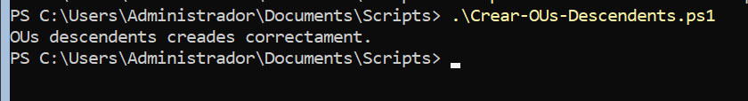

- 7.4. Crea un script que creï l'OU principal si no existeix i que creï únicament les UO descendents que encara no existeixin. El script s'ha de poder executar més d'una vegada sense generar errors ni duplicar objectes.

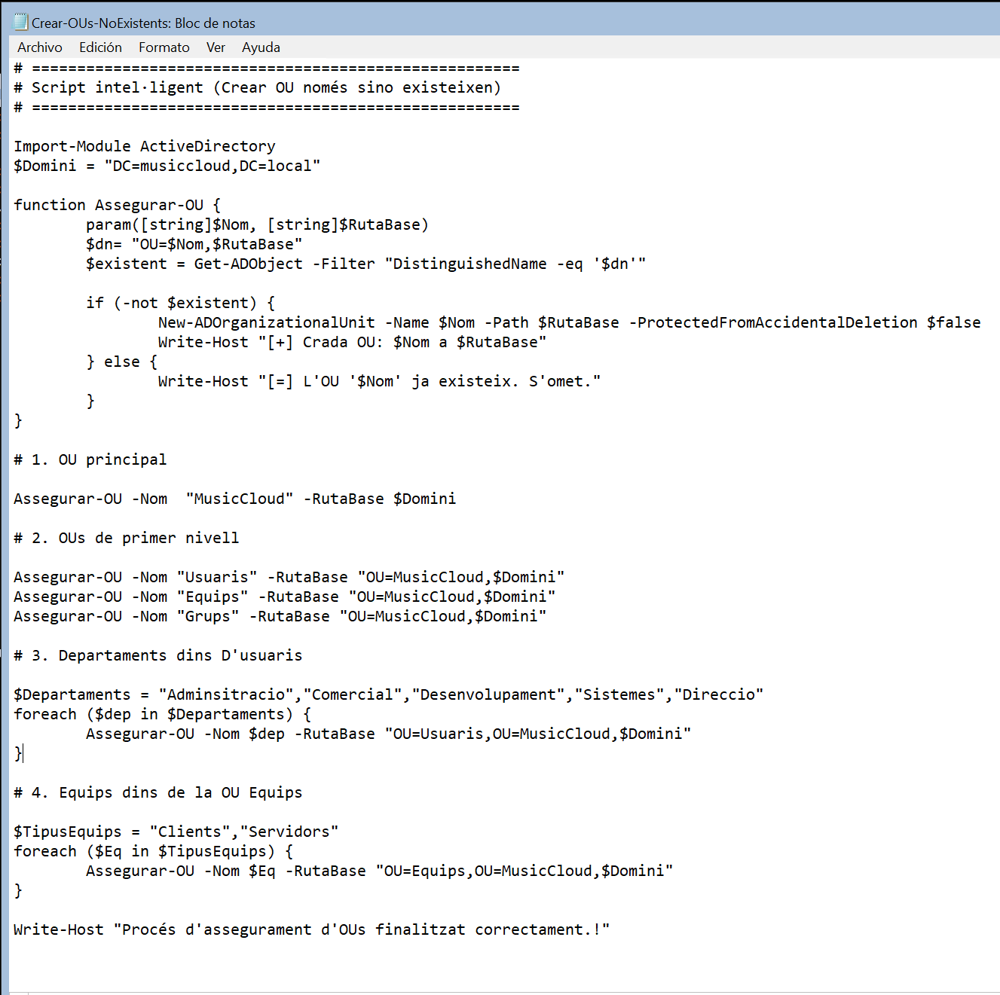

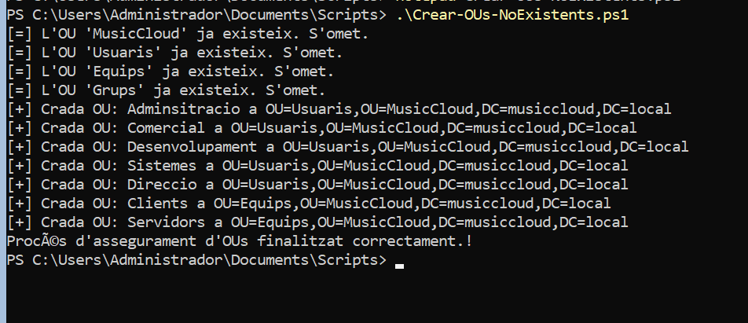


