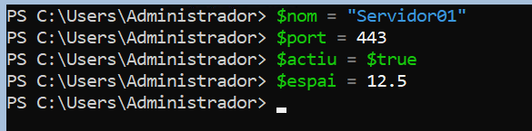
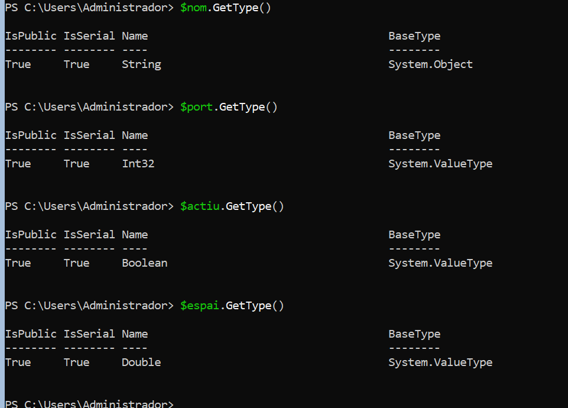
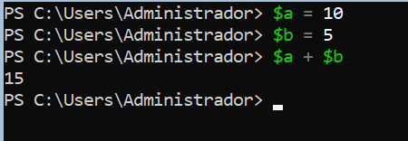
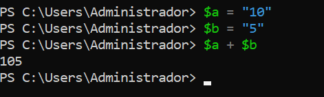
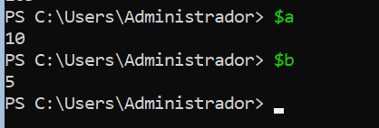
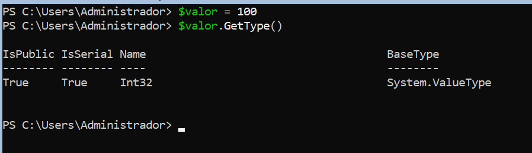
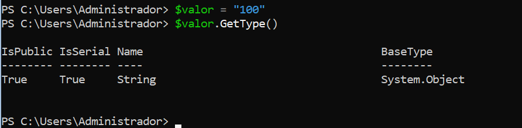
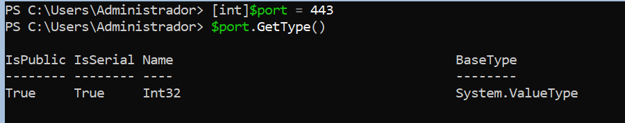
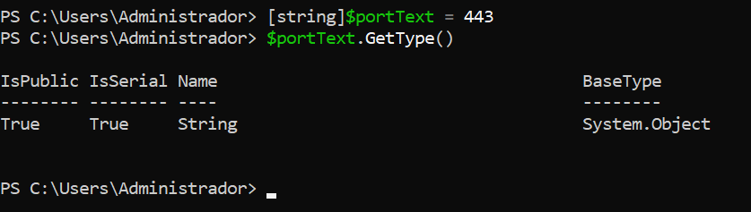

> **Nota**: Els exercicis/pràctiques t'han de servir per a familiarizar-te amb el llenguatge Powershell. Aprofita per a realitzar diverses proves i veure què passa. Documenta també aquestes proves i resultats.
# Tipus de dades

## 1. Identificar tipus

Crea les variables següents:
```powershell
$nom = "Servidor01"
$port = 443
$actiu = $true
$espai = 12.5
```



Consulta el tipus de cadascuna amb:
```powershell
.GetType()
```



Completa una taula com aquesta:

| Variable | Valor        | Tipus       |
| -------- | ------------ | ------------|
| $nom     | `Servidor01` | String      |
| $port    | `443`        | Int32       |
| $actiu   | $true        | Boolean     |
| $espai   | `12.5`       | Double      |
## 2. Número o text?

Executa:
```powershell
$a = 10
$b = 5

$a + $b
```


Després:
```powershell
$a = "10"
$b = "5"

$a + $b
```


Respon:

- Quin resultat obtens en cada cas?

  *En el primer cas el resultat és `15`, i en el segon és `105`.*
- Per què no és el mateix? Mostra després el contingut de cadascuna de les variables.

*No és el mateix, ja que en el primer cas les variables són nombres enters i, per tant, es poden fer operacions matemàtiques com sumar, restar, multiplicar, etc. En canvi, en el segon cas són cadenes de text i, per tant, no es fa una operació matemàtica, sinó que es concatena el text.*



- Quin tipus tenen $a i $b en cada cas?

  *En el primer cas, `$a` i `$b` són de tipus `Int32`. En el segon, són de tipus `String`.*

## 3. Canviar el tipus d'una variable

Executa:
```powershell
$valor = 100
```
Consulta:
```powershell
$valor.GetType()
```


Ara executa:
```powershell
$valor = "100"
```
i torna a consultar:
```powershell
$valor.GetType()
```



Respon:
**Ha canviat el valor? Ha canviat el tipus?**

*El valor representat contiuna sent `100`, però el tipus de dada és el que ha canviat.* 

*Abans era `Int32`, ja que és un nombre enter; després, el tipus ha canviat a `String`, ja que ara és text.*


## 4. Tipus explícits

Executa:
```powershell
[int]$port = 443
```
Comprova el tipus:
```powershell
$port.GetType()
```



Ara prova:
```
[string]$portText = 443
```
Consulta també:
```powershell
$portText.GetType()
```




Respon:

*No, els dos valors no són del mateix tipus. `$port` és de tipus `Int32`, ja que s'ha definit com un nombre enter amb [int]. En canvi, `$portText` és de tipus `String`, ja que s'ha definit com a text amb [String].*

**Tot i que visualment els dos valors semblen `443`, són del mateix tipus?**

*No, tot i que visualment els dos valors mostren `443`, el primer és un nombre enter i el segon és una cadena de text.*

## 5. Booleans

Crea:
```powershell
$serveiActiu = $true
$servidorDisponible = $false
```
Consulta els tipus.

Després mostra un missatge amb:
```
Write-Host "Servei actiu: $serveiActiu"
Write-Host "Servidor disponible: $servidorDisponible"
```
## 6. General

Crea variables per representar un servidor amb aquesta informació:
```
Nom: SRV-WEB01
Port: 443
Espai lliure: 125.7 GB
Actiu: True
```
Després:

1. mostra el valor de totes les variables;
2. consulta el tipus de cadascuna;
3. indica quin tipus de dada has utilitzat per cada valor.