# `Select-Object` i `Where-Object`


## 1. Investigar els objectes

Executa:
```
Get-Process
```
Observa la informació que mostra PowerShell.

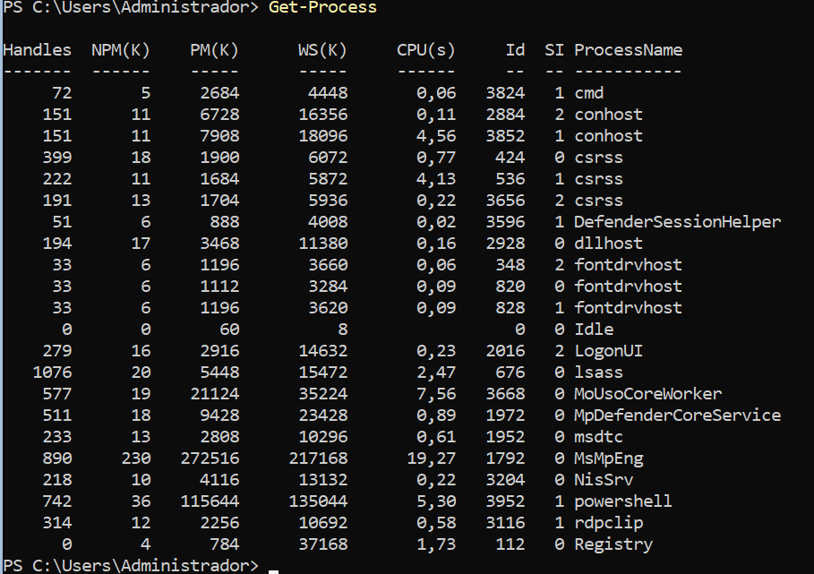


Ara investiga un procés amb:

```
Get-Process |
    Select-Object -First 1 |
    Select-Object *
```

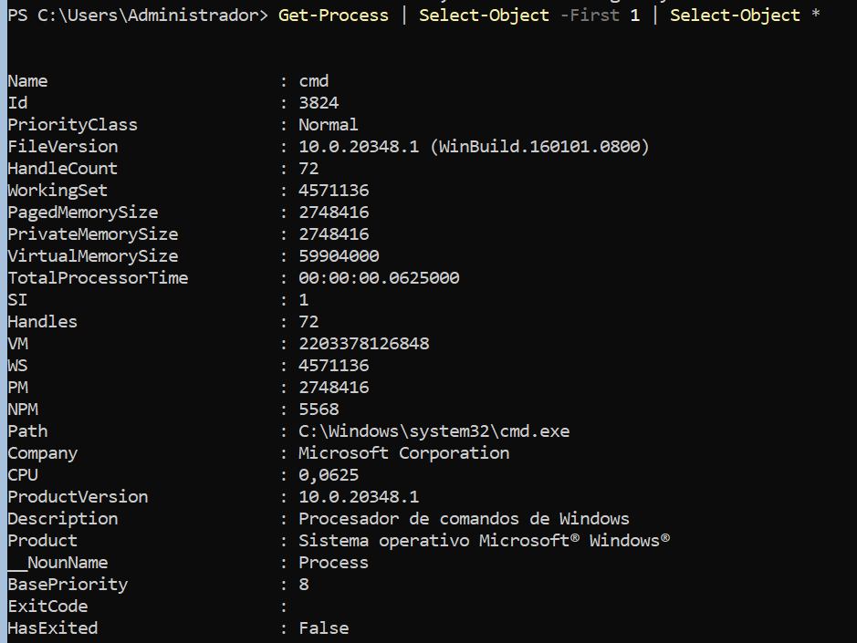

i:
```
Get-Process |
    Get-Member
```

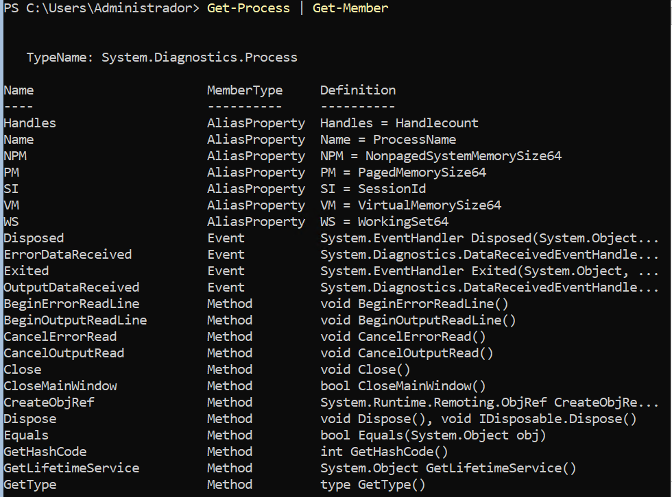

Respon:

1. `Get-Process` mostra inicialment totes les propietats de l'objecte?
   
   *No, Mostra una selecció de propietats en una vista resumida, no necessàriament mostra totes les propietats.*

2. Quina diferència hi ha entre `Select-Object *` i `Get-Member`?
   
   *`Select-Object` mostra els valors de totes les propietats de l'objecta seleccionat. `Get-Member` mostra els membres disponibles, com ara les propietats i els mètodes, i els seus tiups.*

3. Localitza almenys tres propietats que no coneixies. 
  
  *`Handles`, `WorkingSet`,`StartTime`.*
Utilitza després `Select-Object` per mostrar únicament tres propietats que consideris útils.

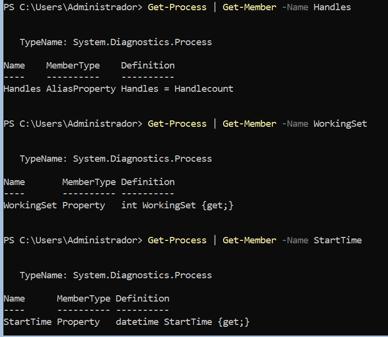

## 2. Seleccionar propietats i objectes

Amb `Get-Process`, construeix ordres que permetin:

1. mostrar només `Name` i `CPU`;
   
   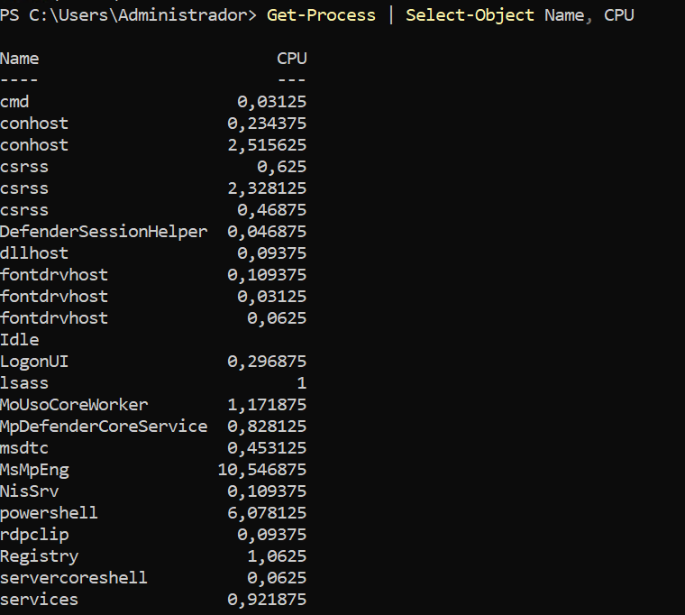
    
2. mostrar només `Name`, `Id` i `CPU`;
    
    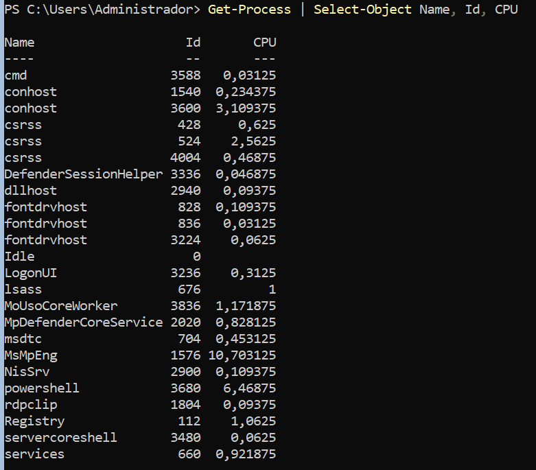

3. mostrar només els cinc primers processos;
    
    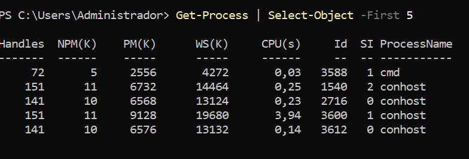

4. mostrar només els tres últims processos.
    
    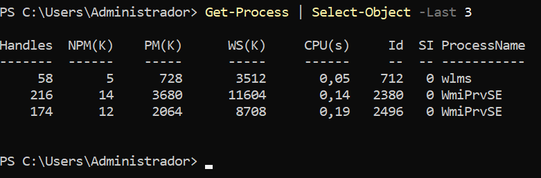

Respon:

**Quina diferència hi ha entre seleccionar propietats i seleccionar objectes?**

*Seleccionar propietats significa decidir quines dades de cada objecte volem mostrar.*

*Seleccionar objectes significa decidir quins elements de la llista volem conservar.*

## 3. Ordenar i seleccionar

Construeix un pipeline que mostri els **cinc processos amb més CPU**.

La sortida ha de mostrar únicament:

```
Name
Id
CPU
```

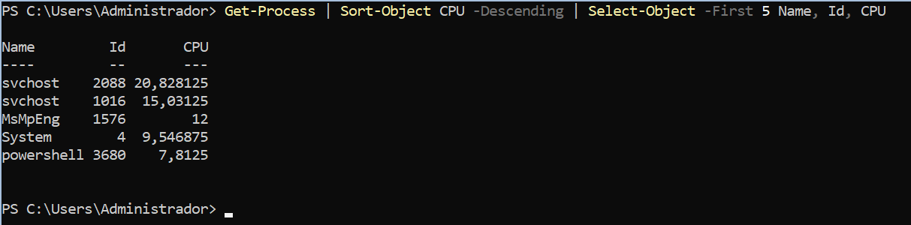

Compara després aquestes dues estratègies:

```
ordenar → seleccionar 5
```

i:

```
seleccionar 5 → ordenar
```

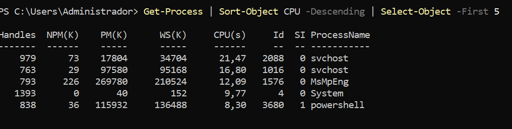

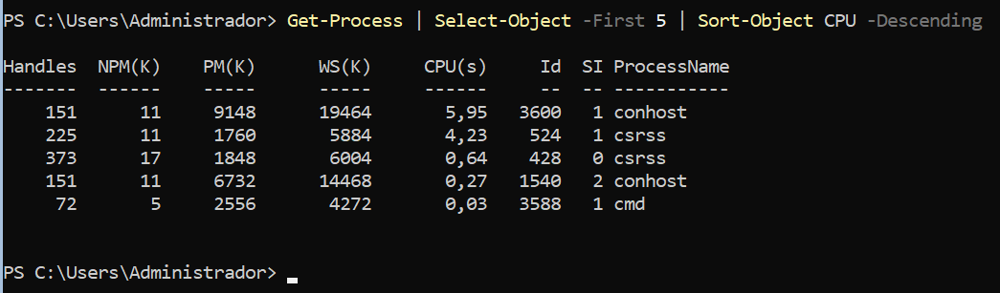


Respon:

1. Fan el mateix?
   
    *No*

2. Per què?
    
    *En el primer cas, s'ordenen tots els processos i després se seleccionen els cinc que tenen més CPU acumulada. En el segon cas, primer se seleccionen cinc processos de la llista original i només s'ordenen aquests cinc.*

3. Quants processos rep `Sort-Object` en cada cas?
    
    *En el primer cas, rep tots els processos retornats per `Get-Process`. En el segon, només en rep cinc.*


## 4. Primer filtre

Crea:

```
$numeros = 5, 20, 3, 40, 12, 8, 30
```

Utilitzant `Where-Object`, mostra (adjunta comandes):

1. els números superiors a `10`;
    
    *Operador: `-gt` Major que.*
    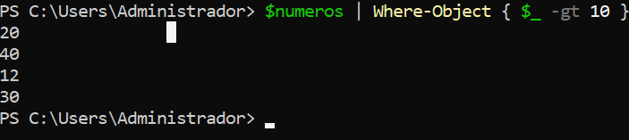

2. els números inferiors a `20`;
    
    *Operador: `-lt` Menor que.*
    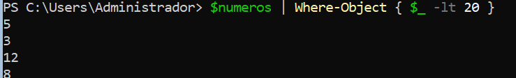

3. els números iguals a `12`;
    
    *Operador: `-eq` Igual que.*
    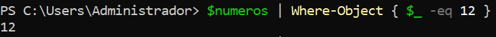

4. tots els números diferents de `20`.
    
    *Operador: `-ne` Diferent de.*
    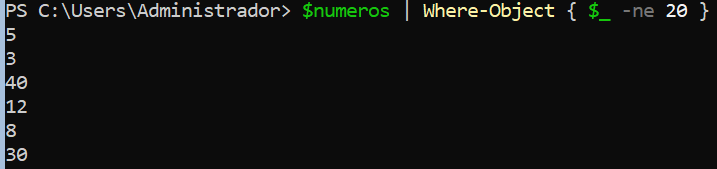


## 5. Entendre `$_`

Utilitza:

```
$numeros = 5, 20, 3
```

i analitza:

```
$numeros |
    Where-Object { $_ -gt 10 }
```

Completa:

|Valor de `$_`|Resultat de `$_ -gt 10`|Passa el filtre?|
|---|---|---|
|5|False (5 < 10)|No|
|20|True (20 > 10)|Si|
|3|False (3 < 10)|No|

Explica amb les teves paraules:

**Què representa** `$_`**?**

*`$_` representa l'element actual que s'està comprovant dins del `Where-Object`. En aquest cas, representa cada número de l'array: Primer és el 5, després el 20 i finalment el 3, però només passen el filtre els números que són més grans que 10.*

## 6. Filtrar objectes per propietats

Executa:

```
Get-Service
```

Construeix un pipeline que mostri únicament els serveis que estan en execució.

La sortida final ha de mostrar només:

```
Name
Status
```

Després construeix-ne un altre que mostri els serveis que **no** estan en execució.

Respon:

1. Què representa `$_`?
    
2. Què representa `$_.Status`?
    
3. Què fa `Where-Object` amb els objectes que no compleixen la condició?
    
4. Què fa després `Select-Object`?

## 7. Combinar condicions

Crea:

```
$numeros = 1, 5, 10, 15, 20, 25, 30, 40
```

Construeix filtres que mostrin:

1. números entre `10` i `30` ambdós inclosos;
    
2. números inferiors a `10` o superiors a `30`.

## 8. Pipeline complet

Construeix progressivament un pipeline que:

1. obtingui tots els processos;
    
2. deixi només els processos amb `CPU > 5`;
    
3. deixi, a més, només els processos amb `Id > 1000`;
    
4. els ordeni de major a menor CPU;
    
5. mostri només els cinc primers;
    
6. mostri només les propietats:
```
Name
Id
CPU
```

No intentis escriure directament tota l'ordre.

Executa-la després d'afegir cada nova etapa i observa com va canviant el resultat.

Representa finalment el recorregut:

```
Get-Process
     ↓
____________
     ↓
____________
     ↓
____________
     ↓
____________
```

Indica què entra i què surt de cada etapa.

## 9. Detectar errors de raonament

Un alumne vol obtenir els cinc processos amb més CPU:

```
Get-Process |
    Select-Object -First 5 |
    Sort-Object CPU -Descending
```

L'ordre funciona.

**Resol correctament el problema? Justifica la resposta i corregeix-la.**

# 10. Conclusions

Explica amb les teves paraules:

1. Per a què serveix `Select-Object`?
    
2. Quina diferència hi ha entre seleccionar **objectes** i seleccionar **propietats**?
    
3. Quina diferència hi ha entre `Get-Member` i `Select-Object *`?
      
4. Per a què serveix `Where-Object`?
    
5. Què representa `$_`? I `$_.CPU`?
    
6. Què passa amb un objecte quan la condició de `Where-Object` retorna `True`? I quan retorna `False`?
     
7. Explica què entra, què surt i què fa cadascuna de les etapes:
```
Get-Process |
    Where-Object {
        $_.CPU -gt 10 -and $_.Id -gt 1000
    } |
    Sort-Object CPU -Descending |
    Select-Object -First 5 Name, Id, CPU
```
11. Es podria millorar l'ordre anterior fent alguna operació en un altre moment del pipeline? Justifica la resposta.