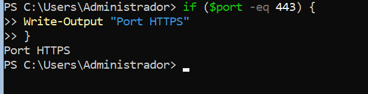
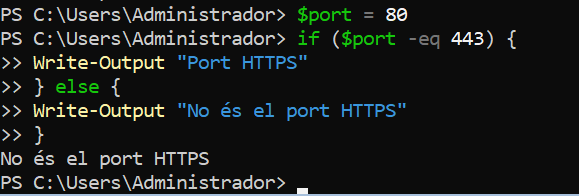
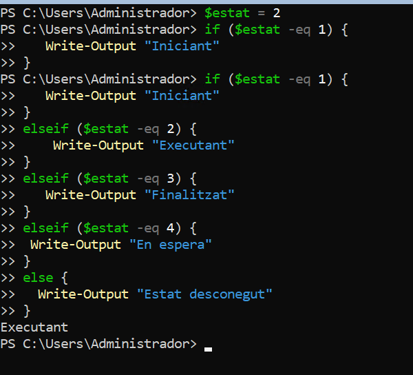
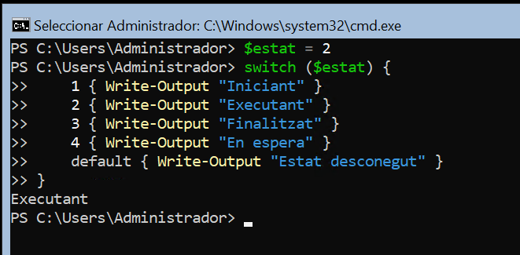
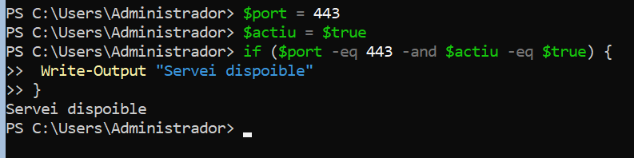

# Pràctica

## 1. Condicional

Crea:
```powershell
$port = 443
```
Mostra:
```
Port HTTPS
```
si el port és `443`.



Canvia després el valor de `$port` i comprova què passa.



## 2. if o switch

Crea:
```
$estat = 2
```
Fes que el programa mostri:

```
1 → Iniciant
2 → Executant
3 → Finalitzat
4 → En espera
qualsevol altre valor → Estat desconegut
```

Resol el problema utilitzant `if` i `switch`. Compara les dues solucions. 





Comparació

- *`if` permet comprovar condicions i combinar-les, per exemple amb `-and` o `-or`.*
- *`switch` és més còmode quan has de comparar una variable amb diversos valors posibles*


## 4. Condicions combinades

Crea:

```powershell
$port = 443
$actiu = $true
```
Mostra:

```text
Servei disponible
```

només quan el port sigui el 443 i estigui actiu




*`-eq` comprova si un valor és igual a un altre, `-and` exigeix que les dues condicions siguin certes.*


## 7. Objectes

Quants serveis en el teu sistema estan configurats amb el servei d'arrencada automàtic quan s'inicia l'equip? 

Proposa diferents codis de resolució.

# Conclusions

Explica amb les teves paraules:

1. Què representa la variable `$servei` en:
```powershell
$serveis = Get-Service
foreach ($servei in $serveis) {
    ...
}
```
2. Quina diferència hi ha entre `foreach` i `ForEach-Object`?
3. Què representa `$_` dins de `ForEach-Object`?