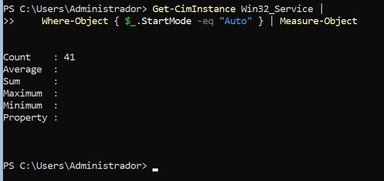
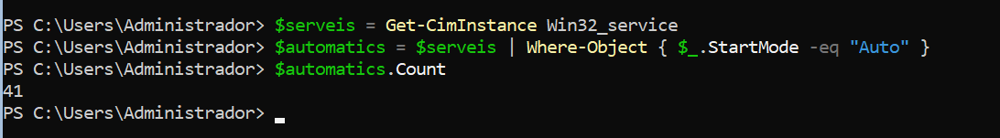
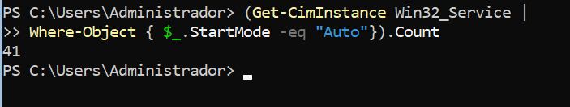

# Pràctica

## 1. Condicional

Crea:
```powershell
$port = 443
```
Mostra:
```
Port HTTPS
```
si el port és `443`.


Canvia després el valor de `$port` i comprova què passa.


## 2. if o switch

Crea:
```
$estat = 2
```
Fes que el programa mostri:

```
1 → Iniciant
2 → Executant
3 → Finalitzat
4 → En espera
qualsevol altre valor → Estat desconegut
```

Resol el problema utilitzant `if` i `switch`. Compara les dues solucions. 


Comparació

- *`if` permet comprovar condicions i combinar-les, per exemple amb `-and` o `-or`.*
- *`switch` és més còmode quan has de comparar una variable amb diversos valors posibles*


## 4. Condicions combinades

Crea:

```powershell
$port = 443
$actiu = $true
```
Mostra:

```text
Servei disponible
```

només quan el port sigui el 443 i estigui actiu


*`-eq` comprova si un valor és igual a un altre, `-and` exigeix que les dues condicions siguin certes.*


## 7. Objectes

Quants serveis en el teu sistema estan configurats amb el servei d'arrencada automàtic quan s'inicia l'equip? 

Proposa diferents codis de resolució.

**Solució 1: *amb `Where-Object` i `Measure-Object`.***



*El resultat mostra el nombre de serveis que tenen l'arrencada automàtica, a la propietat `Count`.*

**Solució 2: *guardant el resultat en una variable.***



*Aquesta solució guarda tots els serveis a `$serveis`, filtra els automàtis i compta els resultats.*

**Solució 3: *mostrant només el recompte.***



*Aquesta solució obté tots els serbeis, filtra el que tenen l'arrencada automàtica i compta directament els resultats amb `.Count`, sense guardarla en una variable.*


# Conclusions

Explica amb les teves paraules:


1. Què representa la variable `$servei` en:
```powershell
$serveis = Get-Service
foreach ($servei in $serveis) {
    ...
}
```

*`$servei` és la variable que representa cada servei individual de la col·lecció `$serveis`. A cada iteració del bucle, conté un servei diferent.*

2. Quina diferència hi ha entre `foreach` i `ForEach-Object`?
   
   - *`foreach` recorre els elements d'una col·leció que ja tens en una variable.*
   - *`ForEach-Object` processa cada objecte que rep a través del pipeline.*
  
3. Què representa `$_` dins de `ForEach-Object`?
   
   *`$_` representa l'objecte actual que s'està processant al pipeline. En aquest exemple, representa cada servei que retorna `Get-Service`.*

```powershell
   Get-Service | ForEach-Object {
        Write-Output $_.Name
   }

```
*`$_.Name` accedeix a la propietat `Name` del servei actual i mostra el seu nom.*

